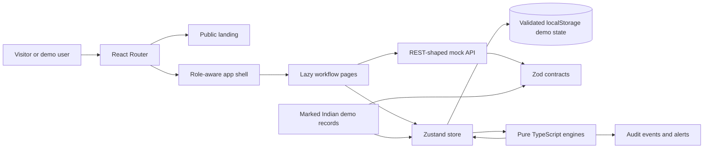

# CasePilot

CasePilot is a Smart India Hackathon 2026 prototype for PS 26262: integrated AICTE approval workflow automation, compliance monitoring and alert management. It tracks illustrative approval cases from submission through post-approval compliance.

Automation coordinates routing, workload, timelines and reminders. Statutory scrutiny, evidence verification, inspection outcomes and decisions remain explicit actions by named human officials. This prototype is not an official AICTE system and does not claim regulatory or security compliance.

## Run locally

Requirements: Node.js 20+ and npm.

```sh
npm install
npm run dev
```

Useful checks:

```sh
npm test
npm run lint
npm run build
```

Open `/` for the public overview, `/login` for the role picker, or `/app` for the current demo workspace after choosing a role. No real authentication or external email/SMS delivery is configured.

## Project structure

```text
src/
  api/          REST-shaped mock API boundary
  components/   Shared primitives and editable React Bits source
  data/         Zod contracts, demo actors, IDs and seed dataset
  design/       Forest/cream tokens and global/landing styles
  engine/       Pure routing, stage, SLA, escalation and compliance rules
  pages/        Public landing and role-specific workflow screens
  store/        Persisted Zustand demo state and injected clock
  utils/        CSV export helpers
```

The public page is route-lazy. The R3F scene and report/dashboard page chunks load separately. `public/images/case-flow.svg` supplies a no-WebGL and reduced-motion illustration. Campus photography is intentionally omitted; if approved locally sourced images become available, candidates can be placed under `public/images/` and added with attribution.

## Architecture



## Demo data

The seed generator creates about 60 cases across eight Regions, 15 Indian institutions, 12 named demo officers, five committees, 25 undertakings, 24 document records and 150 initial audit events. Records are illustrative. They include returned cases, aged EVC work, expired and expiring documents, unverified evidence and escalated cases.

The demo date begins at 28 October 2026, 09:00 IST. Use **Demo controls** in the top bar to advance by 1, 7 or 30 days; use **Reset demo data** in the sidebar to restore the seed dataset and clock.

## Rules engine

- `routeResolver.ts` selects a configured route, rule code, version and human-readable reason.
- `stageMachine.ts` validates stage transitions. Authorized returns/reverts require a reason; completion records the acting officer.
- `slaEngine.ts` evaluates stage age and due-soon/overdue state against the active timeline configuration.
- `escalationEngine.ts` advances aged cases through Regional Officer, Bureau Officer and Authority thresholds.
- `complianceEngine.ts` evaluates document expiry, undertaking deadlines, evidence status and configurable compliance escalation levels.
- `humanActions.ts` keeps decisions and evidence verification explicit and records the officer name. Approval can create a linked, dated undertaking in the same audited action.
- `rulesEngine.ts` versions proposed routes, timelines, alert windows and escalation settings. A second authorized officer is required to activate a proposal.

Engine functions accept their current time as an argument. Advancing the store’s demo clock re-runs the SLA, escalation and compliance engines and appends new alerts and audit events. Their results are workflow recommendations and status signals; they do not make statutory decisions.

## Replacing the mock API

`src/api/mockApi.ts` is the future service seam. Keep its asynchronous method signatures (`getDataset`, `listCases`, `getCase`, `updateCase`, `listAuditEvents`, `reset`) and replace the in-memory implementation with `fetch` calls to a Node.js REST service. Validate request and response payloads with the existing Zod schemas at the boundary. A service can then persist normalized institutions, cases, documents, observations, undertakings, alerts, rules and audit events in PostgreSQL.

For a deployed system, replace the demo role picker with the approved identity provider, enforce authorization on the server for every write, store document contents in the approved encrypted file store, and connect only approved notification services. These are architecture targets; the current prototype stores metadata in the browser and simulates delivery channels.

## Three-minute demo script

1. Open `/` and choose **Launch live demo**. Choose **Institution**.
2. Select **New application**. Keep the first demo institution and **New Institution**, continue through the checked document list and review the `RT-NEW-01` route explanation, then choose **Submit application**. Note the generated case ID and route reason.
3. In the case header, switch to **Regional Officer**. On the case Overview, choose **Return with reason**, enter `Attach the signed fire safety NOC for the proposed campus.` and confirm.
4. Switch to **Institution**, reopen the returned case and choose **Submit response**. Switch to **Regional Officer** and choose **Forward to next stage**.
5. At EVC, choose a future date/time and **Save schedule**. Enter an inspection report summary and choose **Record EVC report and forward**.
6. Switch to **Committee**, open the assigned case, enter a reasoned recommendation and choose **Record committee outcome**.
7. Switch to **Authority**. Enter the statutory reason and review the proposed undertaking title/due date. Choose **Record approval + undertaking**.
8. Open **Demo controls** and advance **+7 days** to surface due-soon reminders. Advance **+30 days** to see overdue status and configured escalations on aged EVC, document and undertaking items.
9. Open **Audit trail** to review the named return, response, stage movements, committee outcome, decision, undertaking and clock-generated events. Open **Reports**, choose a report and **Export CSV**.
10. Use **Reset demo data** before repeating the walkthrough.

Talk track: the route engine explains its rule; every return carries a reason; inspection, committee outcome, verification and Authority decision are human actions; the clock demonstrates alerts/escalations; the audit record shows who did what and when.

## PS 26262 implementation checklist

| Requirement | Where to review |
|---|---|
| Application routing | `/app/apply` route explanation; `/app/rules` configurable route map and version history |
| Role-specific dashboards | `/app` as Institution, Regional Officer, Bureau Officer, Committee and Authority |
| Pendency and ageing | Role dashboards, `/app/cases`, `/app/reports` |
| EVC queue and alerts | `/app/evc`, case EVC scheduling/report actions, `/app/alerts` |
| Undertakings | `/app/compliance`; Authority approval can add a linked undertaking on a case |
| Lease/document expiry | `/app/documents`; 30/15/7-day windows and overdue alert/escalation output |
| Compliance evidence submission | Institution actions in `/app/compliance`; human verification remains an officer action |
| Escalation ladder | `/app/alerts`, `/app/settings`, and `/app/debug` engine console |
| Audit trail | `/app/audit`; CSV export with actor, action, time, before/after and reason fields |
| Human-oversight safeguard | Disabled Authority decision for other roles, explicit EVC/committee/verification actions and persistent app footer note |

## Reference links

The landing page links to the AICTE Approval Process Handbook 2024–27, NeSDA Way Forward, GIGW 3.0, CERT-In application security guidelines, CERT-In government entity security guidance, the DPDP Act 2023 and DPDP Rules 2025. These are reference points for review; their presence does not certify compliance.
